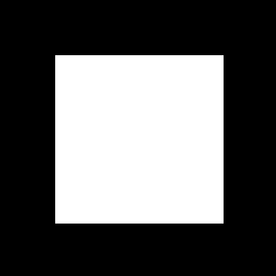
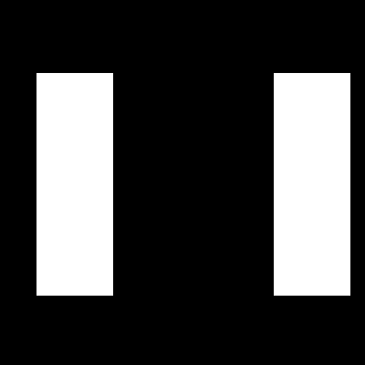
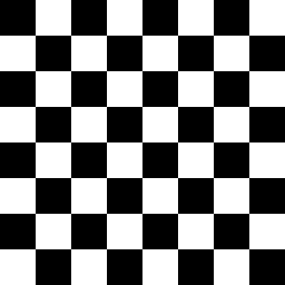

# RixToImg

A small C++ command-line tool that turns a **matrix of numbers into an image**.

Give it a text file of numbers (or one of the built-in demos) and it writes a PNG where each number becomes one pixel: 0 is black and 255 is white. Matrices with values between 0 and 1 are detected automatically and scaled to the full range.

| UV^T demo | UW^T demo | Checkerboard file |
|---|---|---|
|  |  |  |

## Features

- Reads matrices from CSV, space-separated or tab-separated text files
- Auto-detects 0-1 matrices and scales them to 0-255 (`--raw` turns this off)
- Built-in demos that build matrices from vector products (`u * v^T`)
- Enlarges small matrices with nearest-neighbour scaling so pixels stay sharp
- Saves lossless PNG output
- Clear error messages for missing files, bad numbers and uneven rows

## Requirements

- A C++17 compiler
- CMake 3.10 or newer
- OpenCV (tested with 5.0)

### Windows (MSYS2 UCRT64)

Install [MSYS2](https://www.msys2.org), open the **MSYS2 UCRT64** terminal and run:

```bash
pacman -S mingw-w64-ucrt-x86_64-toolchain mingw-w64-ucrt-x86_64-cmake \
          mingw-w64-ucrt-x86_64-ninja mingw-w64-ucrt-x86_64-opencv \
          mingw-w64-ucrt-x86_64-qt6-base
```

The Qt6 package is needed because this OpenCV build uses Qt for its image windows.

### Linux / macOS

Install OpenCV, CMake and a compiler with your package manager (for example `sudo apt install libopencv-dev cmake g++` or `brew install opencv cmake`).

## Build

```bash
git clone https://github.com/<diwtandon>/RixToImg.git
cd RixToImg
mkdir build && cd build
cmake .. -G Ninja      
ninja                  
```

## Usage

```bash
./rixtoimg examples/checkerboard.csv --scale 40 --show


./rixtoimg --demo uv --scale 4
./rixtoimg --demo uw --scale 4 -o uw.png
```

| Option | Meaning |
|---|---|
| `-o, --output <file>` | Output PNG path (default: `output/<name>.png`) |
| `-s, --scale <n>` | Enlarge the image n times (default 1) |
| `--raw` | Treat values as 0-255 even if all are 1 or less |
| `--show` | Open a window with the result |
| `--demo uv\|uw` | Use a built-in demo instead of a file |
| `-h, --help` | Show help |

### Matrix file format

Numbers separated by commas, spaces or tabs, one row per line. Every row must have the same number of values.

```
0,1,0,1
1,0,1,0
```

## The demos

Both come from outer products of 100-element vectors:

- **UV^T**: `u` and `v` are 1 for indices 20 to 80 and 0 elsewhere. The product is a white square on black.
- **UW^T**: `u` is as above, and `w` is 1 for indices 10 to 30 and 75 to 95. The product is two white rectangles.

## How it works

1. `readMatrix` parses the text file into a `cv::Mat` of doubles.
2. The value range is checked. If every value is 1 or less, the factor is 255.
3. `matrixToImage` multiplies by the factor, rounds, and clamps to 0-255 (`cv::Mat::convertTo`).
4. The result is optionally enlarged, then written with `cv::imwrite`.

## Project layout

```
src/        C++ source (main, matrix reader, demos)
examples/   Sample matrices
docs/       Images used in this README
```